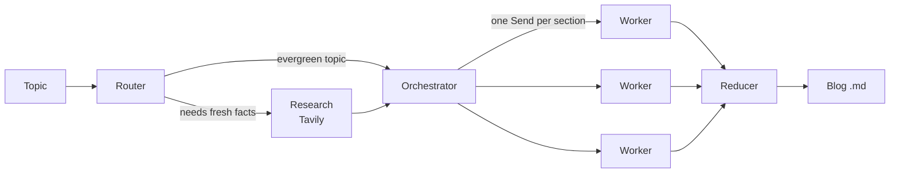

# LangGraph Blog Writing Agent

Give it a topic and it writes a full technical blog post in Markdown, with diagrams.

Built with LangGraph, Gemini, Tavily search and Streamlit.

**Live app:** (https://mashfiq-blog-agent.streamlit.app/)

## How it works

The agent is a LangGraph state graph with five stages:



1. **Router** decides whether the topic needs web research. Each topic gets one of three modes: `closed_book` (concepts that don't change), `hybrid` (mostly stable, but needs current examples) or `open_book` (news, rankings, prices). For the last two it also writes the search queries.
2. **Research** runs the queries on Tavily. Gemini then cleans the raw results into a short, deduplicated evidence list with URLs.
3. **Orchestrator** plans the post: title, audience, tone, and 5–7 sections. Each section gets a goal, bullet points and a target word count. The plan is a Pydantic schema, enforced with structured output.
4. **Workers** write the sections in parallel. Each section is sent as its own task with LangGraph's `Send` API. In `open_book` mode, a worker can only state facts it can cite from the evidence list.
5. **Reducer** is a subgraph. It merges the sections in order, picks up to 3 places where a diagram helps, generates them as Mermaid code and saves the final Markdown file.

## Design choices

- **Mermaid instead of generated images.** Diagrams are written as Mermaid code by the same text model, so no image API is needed. Labels stay readable, and GitHub renders them directly.
- **Truncation guard.** When the model inserts diagram placeholders, it has to return the whole post. If what comes back is much shorter than the original, the agent keeps the original post and skips the diagrams.
- **Safe filenames.** Post titles often contain characters like `:` or `?`. On Windows, a `:` in a filename creates an empty file and hides the text in a separate stream. Titles are cleaned before saving.

## Run locally

```bash
git clone https://github.com/mashfiq-zaman/langgraph-blog-writing-agent.git
cd langgraph-blog-writing-agent
python -m venv venv
venv\Scripts\activate          # macOS/Linux: source venv/bin/activate
pip install -r requirements.txt
```

Create a `.env` file in the project folder:

```
GOOGLE_API_KEY=your_gemini_key
TAVILY_API_KEY=your_tavily_key
```

Then run:

```bash
streamlit run blog_agent_frontend.py
```

Both keys have free tiers: Gemini from [Google AI Studio](https://aistudio.google.com/), Tavily from [tavily.com](https://tavily.com/).

## Project files

| File | What it does |
|---|---|
| `blog_agent_backend.py` | The LangGraph graph: state, schemas, nodes and edges |
| `blog_agent_frontend.py` | Streamlit interface |
| `requirements.txt` | Python dependencies |

## Limitations

- On the Gemini free tier, one post uses roughly 10–15 model calls. Several posts in a row can hit the per-minute limit.
- Research quality depends on what Tavily returns. In `open_book` mode, if no source supports a claim, the section says so instead of guessing.
- Saved files on Streamlit Community Cloud are temporary. Download the post from the app if you want to keep it.

## Next steps

- Add LangSmith tracing so every node's tokens and latency show up in one trace.
- Add a human review step, using LangGraph `interrupt`, so the outline can be approved before the sections are written.
- Build a small evaluation set of topics and score the posts for citation accuracy.
